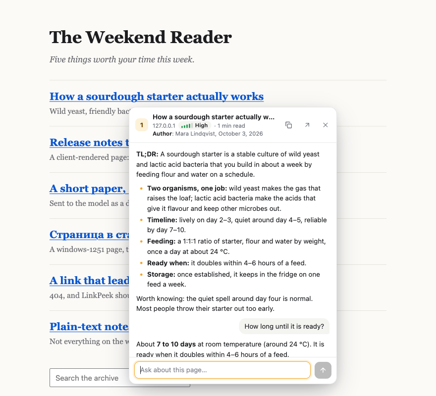

# LinkPeek

**Hold <kbd>X</kbd> and click any link.** A small bubble opens next to it with an AI summary of the page behind the link, and a box to ask follow-up questions. You never leave the page you are reading.

<picture>
  <source media="(prefers-color-scheme: dark)" srcset="docs/bubble-dark.png">
  
</picture>

LinkPeek is a Chrome extension. It uses your own Claude (Anthropic) or OpenAI API key, has no server of its own, no account and no tracking.

## What it does

- **Summarizes the link, in place.** The page is read in the background; the summary streams into a bubble beside the link.
- **Answers questions.** Type in the bubble to ask anything about the linked page. The conversation keeps its context.
- **Shows who is talking.** The bubble's header names the author (or the publishing organization) and the date, next to a five-bar reputation meter for the source.
- **Your format.** One plain-language prompt in the settings controls length, bullets or prose, language and tone. Three presets to start from.
- **Reads what a plain fetch cannot.** Pages that need JavaScript are opened in a muted background tab, read, and closed again. PDFs are sent to the model as documents.
- **One key.** Paste a Claude or an OpenAI key; LinkPeek tells them apart on its own.

## Install

LinkPeek is not on the Chrome Web Store yet. Loading it from source takes a minute:

1. Download this repository (green **Code** button, then **Download ZIP**, and unzip it) or clone it.
2. Open `chrome://extensions` in Chrome.
3. Turn on **Developer mode** (top right).
4. Click **Load unpacked** and choose the repository folder (the one containing `manifest.json`).
5. The settings page opens. Paste your API key. Done.

No build step, no dependencies: the folder is the extension. It needs Chrome 116 or later. Other Chromium browsers (Edge, Brave) should work but are untested.

You need an API key from [Anthropic](https://console.anthropic.com/settings/keys) or [OpenAI](https://platform.openai.com/api-keys). Usage is billed by them to your key; see [Cost](#cost).

## Use

| Do this | To |
| --- | --- |
| Hold <kbd>X</kbd> and click a link | Peek at it |
| Right-click a link, then **Peek at this link** | Same, without the keyboard |
| Type in the bubble, <kbd>Enter</kbd> | Ask about the page (<kbd>Shift</kbd>+<kbd>Enter</kbd> for a new line) |
| <kbd>Esc</kbd> or × | Close the bubble |
| Drag the bubble's header | Move it out of the way |
| Click the title or ↗ | Open the page in a new tab after all |
| Hover over the reputation meter | See what the rating means and why the source got it |

While an answer is streaming, the send button turns into a stop button.

If <kbd>X</kbd> clashes with a site's own keyboard shortcuts, pick another key in the settings.

### The reputation meter


Next to the site name, five bars and one word (Very high, High, Mixed, Low, Very low, or Unknown) say how far the publisher and author can generally be trusted. Hover over it for what the word means, why this source got it, and who decided. It is **the AI's estimate from its general knowledge, not a verified rating**: treat it as a prompt to think, not a verdict. The model is asked about the source only (site, publisher, author, title), never about what the page argues, and it is told to answer "Unknown" rather than guess. Ratings are asked once per source and remembered until you close the browser. You can switch the meter off under Advanced in the settings.

### Local files

To use LinkPeek on a page you opened from disk (`file://…`), open `chrome://extensions`, click **Details** on LinkPeek, turn on **Allow access to file URLs**, and reload the page. Chrome keeps this off for every extension until you allow it.

## Settings

Click the LinkPeek toolbar icon.


- **API key.** Checked against the provider as soon as you paste it.
- **Model.** Defaults to Claude Opus 5.5 or GPT-6.2 Sol. Pick a smaller model for faster, cheaper peeks. The list also shows every model your key can use.
- **Summary format.** The prompt that shapes every summary. For example: `Three bullets, then one sentence on why it matters. Always answer in English.` Edit it and press **Save**; the button lights up while there are unsaved changes and confirms with a green ✓. Choosing a preset applies it at once.
- **Shortcut.** Press **Change key**, then the letter or digit you want to hold instead of <kbd>X</kbd> (<kbd>Alt</kbd>/<kbd>Option</kbd> works too).
- **Advanced.** The reputation meter on or off, and a custom API base URL for proxies and OpenAI-compatible servers such as OpenRouter or a local Ollama (`http://localhost:11434/v1`).

The key, model, shortcut and advanced options are saved as soon as you change them; a green "✓ Saved" appears in the corner of the card each time.

## How a page is read

1. The service worker fetches the link in the background, with your cookies, so pages you are signed in to work.
2. HTML is turned into clean text: navigation, footers, sidebars, scripts and hidden elements are dropped; headings, lists and code are kept. If the page ships its article as structured data, that is used when the visible markup is thin.
3. If that yields almost nothing (a JavaScript app, a bot check), the link is opened in a muted background tab, read once it has rendered, and the tab is closed. Your current tab stays in front the whole time.
4. PDFs up to 15 MB are sent to the model as documents. Plain text, Markdown and JSON are sent as they are.

Very long pages are cut at 100,000 characters (about 16,000 words); the bubble says so when it happens.

## Privacy and security

- Your API key is stored on your device, in the extension's own database, which web pages and the script LinkPeek runs inside them cannot read. It is sent only to the API it belongs to (or to the base URL you set).
- The text of a page you peek at is sent to your model provider, and so are the site name, author and title for the reputation meter. Nothing is sent anywhere else, and nothing is sent until you trigger a peek.
- The bubble lives in a closed shadow root: the page you are on cannot read a summary of some other site.
- Summaries are rendered without `innerHTML`, so nothing a page or a model writes can become markup or script.
- A page cannot trigger a peek by scripting clicks; only real key presses and clicks count.

More detail in [PRIVACY.md](PRIVACY.md). The permissions, and why each is needed:

| Permission | Why |
| --- | --- |
| Access to all sites | A link can point anywhere, and the click has to be noticed on any page |
| Local files (off until you allow it) | Use LinkPeek on pages opened from disk; see [Local files](#local-files) |
| `scripting` | Read the rendered text of a page opened in a background tab |
| `offscreen` | Parse fetched HTML (service workers have no DOM) |
| `storage` | Save your preferences |
| `contextMenus` | The **Peek at this link** menu item |

## Cost

Every peek sends the page text to your provider and is billed to your key. A typical article is roughly 2,000 to 8,000 input tokens plus a short reply; the longest page LinkPeek will send is about 25,000. With Claude, follow-up questions about the same page reuse the prompt cache. The reputation meter adds one very small request (a few hundred tokens) the first time you peek at a source in a browser session. If you peek a lot, choose a smaller model in the settings (Claude Haiku 5.5, GPT-6 Luna).

## Limitations

- Links inside iframes are not picked up.
- On a local `file://` page, links to web pages work; links to other local files do not.
- The author and date come from the page's own metadata. Pages that do not state them get no credit line.
- Videos are summarized from the text on their page (title, description, comments), not from the audio.
- Sites that block automated access may only show their "are you human" page.
- Holding a letter key types it into a focused text box. That is harmless, but it is one more reason the shortcut key is configurable.
- Chrome's own pages (`chrome://`, the Web Store) do not allow extensions.

## Development

Plain JavaScript, no bundler. Edit a file, press the reload button on `chrome://extensions`, and it is live.

```
manifest.json
src/
  background.js        service worker: handles summarize, ask and reputation requests
  content.js           the X+click trigger and the bubble UI
  ui/bubble-css.js     bubble styles
  lib/page-loader.js   fetch, background-tab fallback, PDFs
  lib/extract.js       document to readable text
  lib/providers.js     Claude and OpenAI streaming adapters
  lib/prompts.js       system prompt and message layout
  lib/reputation.js    source reputation: prompt, parsing, what is rateable
  lib/markdown.js      safe Markdown renderer
  lib/settings.js      defaults and storage
  options/             settings page, also the toolbar popup
  offscreen/           hidden page that parses HTML for the service worker
test/
  unit/                logic tests, no browser needed
  e2e/                 the real extension in Chromium against mock APIs
```

```bash
npm test                 # unit tests (Node 20+, nothing to install)
npm install              # once, for the end-to-end test
npx playwright install chromium
npm run test:e2e         # loads the extension into Chromium and drives it
HEADED=1 npm run test:e2e   # watch it run
SHOTS=1 npm run test:e2e    # also refresh docs/*.png
npm run zip              # package for the Chrome Web Store
```

The end-to-end test starts a local server with fixture pages and stand-ins for the Claude and OpenAI APIs. It needs no API key and sends nothing off your machine.

Issues and pull requests are welcome. Please run both test suites before sending a change.

## License

[MIT](LICENSE)
