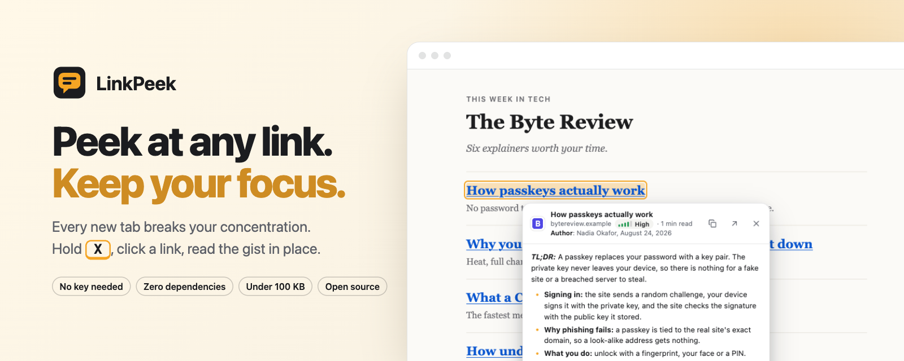
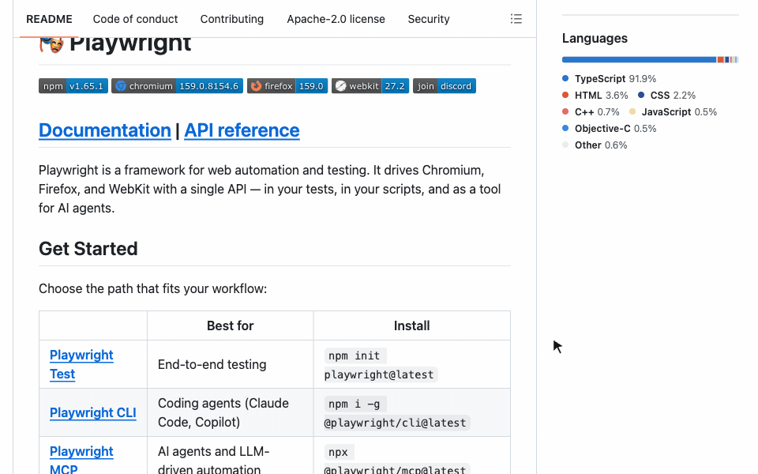
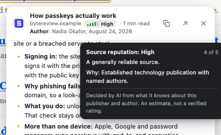
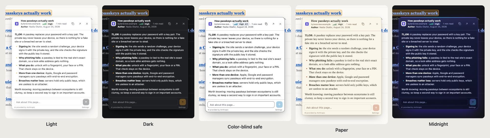
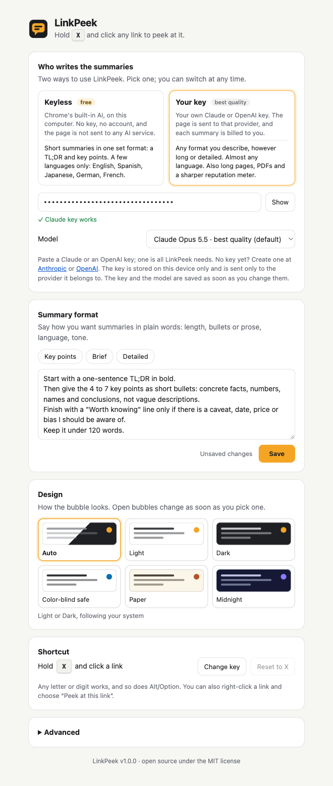

<div align="center">

<h1>
  <picture>
    <source media="(prefers-color-scheme: dark)" srcset="docs/hero-dark.png">
    
  </picture>
</h1>

**A Chrome extension for staying focused. Opening a link in a new tab costs you your train of thought.<br>Hold <kbd>X</kbd> and click it instead: an AI summary opens in a bubble right where you are, and answers your questions.**

[](https://github.com/galinaalperovich/LinkPeek/actions/workflows/test.yml)
[](LICENSE)
[](manifest.json)
[](#light-by-design)
[](#light-by-design)
[](#keyless-or-your-key)
[](#install)

**[Chrome Web Store (coming soon)](#install) · [Privacy](PRIVACY.md) · [Store listing kit](store/listing.md)**

[Install](#install) · [Use](#use) · [Keyless or your key](#keyless-or-your-key) · [Designs](#designs) · [Settings](#settings) · [Light by design](#light-by-design) · [Privacy](#privacy-and-security) · [Cost](#cost) · [Development](#development)

<code>git clone https://github.com/galinaalperovich/LinkPeek.git</code>

<br><br>



<sub>Recorded on github.com with <code>npm run demo</code>. The page, the link, the icon and the bubble are real. The summary's words are replayed by a local stand-in for the API, so the recording needs no key.</sub>

</div>

<br>

LinkPeek has two modes, and you choose. **Keyless** needs no API key: it uses the AI model built into Chrome, which runs on your own computer. **Your key** uses your own Claude (Anthropic) or OpenAI key for the best summaries. Either way there is no server of its own, no account and no tracking.

- **Keyless.** Summaries are made by Chrome's built-in AI, on your computer. It is free, it works offline, and the page is not sent to any AI service. Summaries are short and come in one set format. See [Keyless or your key](#keyless-or-your-key) for what your computer needs.
- **Summarizes the link, in place.** The page is read in the background and the summary streams into a bubble beside the link. The link is highlighted while its bubble is open, so you always see what the bubble is about.
- **Answers questions.** Type in the bubble to ask anything about the linked page. The conversation keeps its context.
- **Shows who is talking.** The header carries the site's own icon, the author or publishing organization, the date, and a five-bar reputation meter for the source.
- **Remembers.** Peek at the same page again and the saved summary appears at once, with no new request, as long as the page has not changed.
- **Five designs.** Light, Dark, Color-blind safe, Paper and Midnight, or Auto to follow your system.
- **Your format.** With your key, one plain-language prompt controls length, bullets or prose, language and tone.
- **Reads what a plain fetch cannot.** Pages that need JavaScript are opened in a muted background tab, read, and closed again. PDFs are sent to the model as documents.
- **Or your key.** Paste a Claude or an OpenAI key for the best summaries, any format, any language, long pages and PDFs; LinkPeek tells the two apart on its own.
- **Light.** Zero dependencies, under 100 KB, no server. See [Light by design](#light-by-design).

---

## Install

The Chrome Web Store version is on its way. Until then, installing takes two minutes and no programming. Do these six steps in order.

**1. Download LinkPeek.**
Click this link: **[Download LinkPeek](https://github.com/galinaalperovich/LinkPeek/archive/refs/heads/main.zip)**.
A file named `LinkPeek-main.zip` appears in your Downloads folder.

**2. Unzip it.**
Double-click that file. You now have a folder named `LinkPeek-main`.
Keep this folder. If you delete it, LinkPeek stops working.

**3. Open the extensions page in Chrome.**
Click the address bar at the top of Chrome, type `chrome://extensions` and press Enter.

**4. Turn on "Developer mode".**
It is a small switch in the top-right corner of that page. Click it once so it turns blue.

**5. Click "Load unpacked".**
The button is in the top-left corner. A file window opens. Pick the `LinkPeek-main` folder and click **Select**.

**6. Look at the first box.**
A LinkPeek page opens by itself. Its first box, **Who writes the summaries**, has two choices: **Keyless** and **Your key**. On most recent computers Keyless is already chosen.

- Under Keyless it says **✓ Ready**: you are done. No key, no account, nothing to pay.
- It says **One step left**: Keyless needs Chrome's AI model, a one-time download of about 4 GB. It starts by itself with your first click on that page, or with your first peek, and the page shows how far it is.
- **Your key** is chosen instead, because your computer cannot run Keyless: paste an API key into the box. See [I do not have a key](#i-do-not-have-a-key).

**Now try it:** open any website, hold down the <kbd>X</kbd> key, and click a link. With Keyless, the very first summary takes 10 to 30 seconds while Chrome wakes its AI up. After that they come quickly.

Prefer the terminal? Clone instead of downloading, then do steps 3 to 6 with the cloned folder:

```bash
git clone https://github.com/galinaalperovich/LinkPeek.git
```

### I do not have a key

You may not need one. If **Keyless** is chosen in the settings and says **✓ Ready**, LinkPeek already works: see [Keyless or your key](#keyless-or-your-key).

A key is a long password that lets LinkPeek use a bigger AI for you, for better summaries. You get one from either company:

- **Claude:** open [console.anthropic.com/settings/keys](https://console.anthropic.com/settings/keys), sign up, click **Create Key**, copy it.
- **OpenAI:** open [platform.openai.com/api-keys](https://platform.openai.com/api-keys), sign up, click **Create new secret key**, copy it.

Both ask for a payment card. Each summary costs between a fraction of a cent and a few cents, depending on the model you pick; see [Cost](#cost).

### It does not work

- **Nothing happens when I click.** Keep <kbd>X</kbd> held down *while* you click the link. If it still does nothing, reload the page and try again.
- **The first summary is slow.** In Keyless mode, Chrome has to wake its AI model up, which takes 10 to 30 seconds. It stays awake for a few minutes after each peek.
- **The bubble says "one step left".** Click **Turn on Keyless** in the bubble. Chrome then downloads its AI model (about 4 GB, once) and the summary follows by itself.
- **The bubble says Keyless cannot run on this computer.** Click **Open settings**, choose **Your key**, and paste a key.
- **It works on some pages but not on others.** Chrome does not let any extension run on its own pages (the new-tab page, settings, the Chrome Web Store).
- **The bubble shows an error about the key.** Click the puzzle-piece icon at the top right of Chrome, click **LinkPeek**, and paste the key again.
- **I want to change the X key or the look.** Same place: puzzle-piece icon, then **LinkPeek**. Every bubble also has a small **Settings** link at the bottom.

LinkPeek needs Chrome 119 or later; Keyless needs Chrome 138 or later. Other Chromium browsers (Edge, Brave) should work with a key but are untested.

## Use

<picture>
  <source media="(prefers-color-scheme: dark)" srcset="docs/bubble-dark.png">
  
</picture>

| Do this | To |
| --- | --- |
| Hold <kbd>X</kbd> and click a link | Peek at it |
| Right-click a link, then **Peek at this link** | Same, without the keyboard |
| Type in the bubble, <kbd>Enter</kbd> | Ask about the page (<kbd>Shift</kbd>+<kbd>Enter</kbd> for a new line) |
| Click anywhere else, <kbd>Esc</kbd> or × | Close the bubble |
| Drag the bubble's header | Move it out of the way |
| Click the title or ↗ | Open the page in a new tab after all |
| Hover over the title | Read it in full, with the address |
| Hover over the reputation meter | See what the rating means and why the source got it |
| Click **Summarize again** under a saved summary | Get a fresh summary instead of the saved one |

While an answer is streaming, the send button turns into a stop button.

It also works on links inside embedded pages (frames), such as a document viewer, a dashboard widget or a claude.ai artifact: hold <kbd>X</kbd> and click as usual.

If <kbd>X</kbd> clashes with a site's own keyboard shortcuts, pick another key in the settings.

### The reputation meter



Next to the site name, five bars and one word (Very high, High, Mixed, Low, Very low, or Unknown) say how far the publisher and author can generally be trusted. Hover over it for what the word means, why this source got it, and who decided. It is **the AI's estimate from its general knowledge, not a verified rating**: treat it as a prompt to think, not a verdict. The model is asked about the source only (site, publisher, author, title), never about what the page argues, and it is told to answer "Unknown" rather than guess. Ratings are asked once per source and remembered until you close the browser. You can switch the meter off under Advanced in the settings.

In Keyless mode the rating comes from Chrome's small on-device model, and the hover card says so. In tests it placed well-known sources sensibly (Reuters and Nature at the top, Infowars at the bottom), but for a site it had never heard of it tended to answer "Mixed" while admitting, in its own reason, that it did not know the source. LinkPeek takes it at its word: such a rating is shown as **Unknown**. It is made after the summary, so it never holds the summary up, and nothing about the source leaves your computer.

### Saved summaries

When a summary finishes, LinkPeek saves it on your device under a fingerprint (a SHA-256 hash) of the page's content, your format prompt and the model. The next time you peek at that link, the page is fetched again and fingerprinted; if nothing changed, the saved summary is shown at once and the model is not called. If the page, the format or the model changed, you get a new summary. Saved summaries are kept for 30 days, at most 300 of them, never from incognito windows, and can be cleared under Advanced in the settings.

### Local files

To use LinkPeek on a page you opened from disk (`file://…`), open `chrome://extensions`, click **Details** on LinkPeek, turn on **Allow access to file URLs**, and reload the page. Chrome keeps this off for every extension until you allow it.

## Keyless or your key

The first box in the settings asks who writes the summaries. There are two answers, and the choice is yours: LinkPeek never switches by itself, not even when you paste or remove a key.

| | **Keyless** | **Your key** |
| --- | --- | --- |
| What it is | Chrome's built-in AI (Gemini Nano), running on your computer | Your own Claude or OpenAI API key |
| Cost | Free | Billed to your key, see [Cost](#cost) |
| Where the page goes | Nowhere: it stays on your computer | To your AI provider |
| Summary format | One set format: a TL;DR and 4 to 6 key points | Any format you describe, however long or detailed |
| Languages | A few: English, Spanish, Japanese, German, French | Almost any |
| Quality | Good for a quick gist | Much better |
| First summary | 10 to 30 seconds while the model wakes up, then about 5 to 10 | A few seconds |
| Long pages | About the first 4,000 to 6,000 words | About the first 16,000 words |
| PDFs | No | Yes |
| Reputation meter | Yes, a rougher estimate | Yes |

The bubble looks the same in both modes. The header (site icon, title, author or publisher, date, reading time) is read from the page itself, so it needs no AI. A Keyless summary opens with the same bold **TL;DR** line as one made with a key, followed by key points, and you can ask follow-up questions either way. A small line at the bottom of every bubble says who answered: **AI running on this device**, or **AI provided by Anthropic** or **OpenAI** (or the name of the server, if you set your own API address).

**What Keyless needs** (these are Chrome's requirements, not LinkPeek's):

- Chrome 138 or later on Windows, macOS, Linux or a Chromebook Plus. Not on phones.
- About 22 GB of free disk space. The model itself is around 4 GB, downloaded once.
- 16 GB of memory, or a graphics card with more than 4 GB.

Under Keyless, the settings tell you where you stand: **✓ Ready**, **One step left** while the model still has to be downloaded, or a plain statement that this computer cannot run it. The first time you open the settings, LinkPeek starts you on Keyless if your computer can run it and on Your key if it cannot. After that it leaves the choice alone. A saved key stays saved when you switch to Keyless; it is just not used.

**When the model is downloaded.** Chrome downloads its AI model once, about 4 GB, and refuses to start that download without a click from you: an extension cannot do it silently while it installs. So LinkPeek uses the first click it legitimately has. With Keyless chosen, that is your first click anywhere on the settings page that opens after installing, or your first X+click on a link: the bubble then shows the download's progress and the summary follows by itself. If a bubble is opened some other way before the model is there, it offers a **Turn on Keyless** button. Chrome only downloads on an unmetered connection, and removes the model again if disk space runs low; LinkPeek brings it back the same way.

**Why Keyless has a set format.** Chrome's built-in model is small. In tests on real pages it kept reliably to a shape it was shown, but treated free-form instructions loosely: asked for "two or three sentences, no bullets" it wrote 160 to 210 words, sometimes with bullets. So Keyless always uses the one shape it gets right, and the Summary format box is only shown for Your key.

**About languages.** The five listed are the ones Chrome supports for its built-in AI. In testing the model also wrote a good Russian summary of a Russian page, but that is outside what Chrome supports, so treat other languages as a bonus, not a promise.

## Designs



Pick one in the settings, or leave it on **Auto** to follow your system's light or dark mode. An open bubble changes design on the spot.

| Design | What it is |
| --- | --- |
| **Light** | Clean white with an amber accent |
| **Dark** | Graphite with the same amber |
| **Color-blind safe** | Blue and orange in place of red and green. The reputation level is also shown as a number, links are always underlined, errors carry a warning sign, and borders, text and focus rings are stronger |
| **Paper** | A warm page with the summary set in a book typeface |
| **Midnight** | Frosted navy glass with a violet-to-cyan edge |

## Settings

Click the LinkPeek toolbar icon.



- **Who writes the summaries.** **Keyless** or **Your key**, each with what it can and cannot do. Under Keyless: whether Chrome's built-in AI is ready on this computer, and the progress of its one-time download. See [Keyless or your key](#keyless-or-your-key).
- **API key.** Shown when you choose Your key. Checked against the provider as soon as you paste it.
- **Model.** With your key: defaults to Claude Opus 5.5 or GPT-6.2 Sol. Pick a smaller model for faster, cheaper peeks. The list also shows every model your key can use.
- **Summary format.** Shown when you choose Your key (Keyless has its own set format, so the box is hidden there). The prompt that shapes every summary. For example: `Three bullets, then one sentence on why it matters. Always answer in English.` Edit it and press **Save**; the button lights up while there are unsaved changes and confirms with a green ✓. Choosing a preset applies it at once.
- **Design.** One of the five looks above, or Auto.
- **Shortcut.** Press **Change key**, then the letter or digit you want to hold instead of <kbd>X</kbd> (<kbd>Alt</kbd>/<kbd>Option</kbd> works too).
- **Advanced.** The reputation meter on or off, how many summaries are saved (with a Clear button), the provider for your key (detected from the key, or one you pick), and a custom API base URL for proxies and OpenAI-compatible servers such as OpenRouter or a local Ollama (`http://localhost:11434/v1`).

The key, model, design, shortcut and advanced options are saved as soon as you change them; a green "✓ Saved" appears in the corner of the card each time.

## How a page is read

1. The service worker fetches the link in the background, with your cookies, so pages you are signed in to work.
2. HTML is turned into clean text: navigation, footers, sidebars, scripts and hidden elements are dropped; headings, lists and code are kept. If the page ships its article as structured data, that is used when the visible markup is thin.
3. If that yields almost nothing (a JavaScript app, a bot check), the link is opened in a muted background tab, read once it has rendered, and the tab is closed. Your current tab stays in front the whole time.
4. PDFs up to 15 MB are sent to the model as documents. Plain text, Markdown and JSON are sent as they are.

Very long pages are cut at 100,000 characters (about 16,000 words); the bubble says so when it happens. Keyless reads less, about the first 4,000 to 6,000 words, and the bubble says that too.

## Light by design

Most people are right to be wary of browser extensions. LinkPeek is built to be easy to trust:

- **Zero dependencies.** Nothing is installed, bundled or downloaded. There is no `node_modules` in what you run, and no framework.
- **Under 100 KB.** The whole extension is about 5,800 lines of plain JavaScript, HTML and CSS: small enough to read in an afternoon.
- **No build step.** The files in this repository are the files Chrome runs. What you read is what executes.
- **No remote code.** Nothing is loaded from the network, and there is no `eval`.
- **No server.** LinkPeek talks only to the page you peek at and to the AI provider whose key you entered. In Keyless mode, it talks to the page and to nobody else.

A test ([test/unit/lightweight.test.js](test/unit/lightweight.test.js)) fails the build if a dependency, a non-local import, remote code or bloat ever creeps in.

## Privacy and security

- Your API key is stored on your device, in the extension's own database, which web pages and the script LinkPeek runs inside them cannot read. It is sent only to the API it belongs to (or to the base URL you set).
- In Keyless mode, the summary is made by Chrome's built-in AI on your computer. The page text is not sent to anyone. (Chrome downloads that model once, about 4 GB, from Google; see [Keyless or your key](#keyless-or-your-key).)
- With your key, the text of a page you peek at is sent to your model provider, and so are the site name, author and title for the reputation meter. Nothing is sent anywhere else, and nothing is sent until you trigger a peek.
- The bubble lives in a closed shadow root: the page you are on cannot read a summary of some other site.
- Summaries are rendered without `innerHTML`, so nothing a page or a model writes can become markup or script.
- A page cannot trigger a peek by scripting clicks; only real key presses and clicks count.

More detail in [PRIVACY.md](PRIVACY.md). The permissions, and why each is needed:

| Permission | Why |
| --- | --- |
| Access to all sites | A link can point anywhere, and the click has to be noticed on any page, including pages embedded inside other pages |
| Local files (off until you allow it) | Use LinkPeek on pages opened from disk; see [Local files](#local-files) |
| `scripting` | Read the rendered text of a page opened in a background tab |
| `offscreen` | Parse fetched HTML, decode site icons and run Chrome's built-in AI (none of which a service worker can do) |
| `storage` | Save your preferences |
| `contextMenus` | The **Peek at this link** menu item |

## Cost

Keyless costs nothing: Chrome's built-in AI is free. The rest of this section is about using your own key.

Every peek sends the page text to your provider and is billed to your key. A typical article is roughly 2,000 to 8,000 input tokens plus a short reply; the longest page LinkPeek will send is about 25,000. Peeking at an unchanged page again is free: the saved summary is reused. With Claude, follow-up questions about the same page reuse the prompt cache. The reputation meter adds one very small request (a few hundred tokens) the first time you peek at a source in a browser session. If you peek a lot, choose a smaller model in the settings (Claude Haiku 5.5, GPT-6 Luna).

## Limitations

- Keyless runs on a small model. It has one summary format, supports five languages, reads about the first 4,000 to 6,000 words of a page, cannot read PDFs, and its reputation ratings are rougher than a large model's. On a page that is only a login wall or an error message it still writes a tidy summary of that message. Your key removes these limits.
- Inside a page embedded in another page (a frame), the bubble opens inside that frame; if the frame is too small for it, the page around it shows the bubble. A very few embedded pages block extensions altogether.
- On a local `file://` page, links to web pages work; links to other local files do not.
- The author and date come from the page's own metadata. Pages that do not state them get no credit line.
- Pages that change a little on every load (view counts, "3 minutes ago") never match a saved summary, so they are summarized fresh each time.
- Videos are summarized from the text on their page (title, description, comments), not from the audio.
- Sites that block automated access may only show their "are you human" page.
- Holding a letter key types it into a focused text box. That is harmless, but it is one more reason the shortcut key is configurable.
- Chrome's own pages (`chrome://`, the Web Store) do not allow extensions.

## Development

Plain JavaScript, no bundler, zero dependencies. Edit a file, press the reload button on `chrome://extensions`, and it is live.

The only package in `package.json` is Playwright, a development tool that drives the browser tests and takes the screenshots. It is never part of the extension.

```
manifest.json
src/
  background.js        service worker: summarize, ask, reputation and icon requests
  content.js           the X+click trigger and the bubble UI
  ui/bubble-css.js     bubble styles and the five designs
  lib/page-loader.js   fetch, background-tab fallback, PDFs, site icons
  lib/extract.js       document to readable text
  lib/providers.js     Claude and OpenAI streaming adapters
  lib/builtin-ai.js    Keyless (Chrome's built-in AI): state, fitting a page into its context, answering
  lib/builtin-client.js  the service worker's side of it
  lib/prompts.js       system prompts and message layout
  lib/reputation.js    source reputation: prompt, parsing, what is rateable
  lib/summary-cache.js saved summaries, keyed by a hash of content, format and model
  lib/markdown.js      safe Markdown renderer
  lib/settings.js      defaults and storage
  options/             settings page, also the toolbar popup
  offscreen/           hidden page that parses HTML, decodes icons and hosts the built-in AI
test/
  unit/                logic tests, no browser needed
  e2e/                 the real extension in Chromium against mock APIs and a stand-in built-in model
  ondevice/            the real extension in your Chrome with the real built-in model, no key
scripts/
  record-demo.mjs      records docs/demo.gif on a real website
store/                 Chrome Web Store listing text, screenshots and promo tiles
```

```bash
npm test                 # unit tests (Node 20+, nothing to install)
npm install              # once, for everything below
npx playwright install chromium
npm run test:e2e         # loads the extension into Chromium and drives it
HEADED=1 npm run test:e2e   # watch it run
SHOTS=1 npm run test:e2e    # also refresh the pictures in docs/
npm run test:ondevice    # Keyless for real: your Chrome, its built-in model (no window; HEADED=1 to watch)
npm run demo             # re-record docs/demo.gif (needs network and ffmpeg)
npm run store            # refresh the store screenshots and promo tiles in store/
npm run zip              # package for the Chrome Web Store: linkpeek-<version>.zip
```

The end-to-end test starts a local server with fixture pages and stand-ins for the Claude and OpenAI APIs and for Chrome's built-in model. It needs no API key and sends nothing off your machine. CI runs both suites on every push and pull request.

`npm run test:ondevice` is the one test that uses a real model: it starts Google Chrome without a window and with a profile of its own, loads the extension as a fresh install, and peeks at the fixture pages in Keyless mode with Chrome's actual built-in AI, checking that each summary has the promised shape. It needs a computer that can run that model, so it is not part of CI. If your own Chrome has already downloaded the model, the test reuses those files instead of downloading them again.

Publishing to the Chrome Web Store: the listing text, permission justifications and images are in [store/](store/listing.md).

Issues and pull requests are welcome. Please run both test suites before sending a change.

## License

[MIT](LICENSE)
